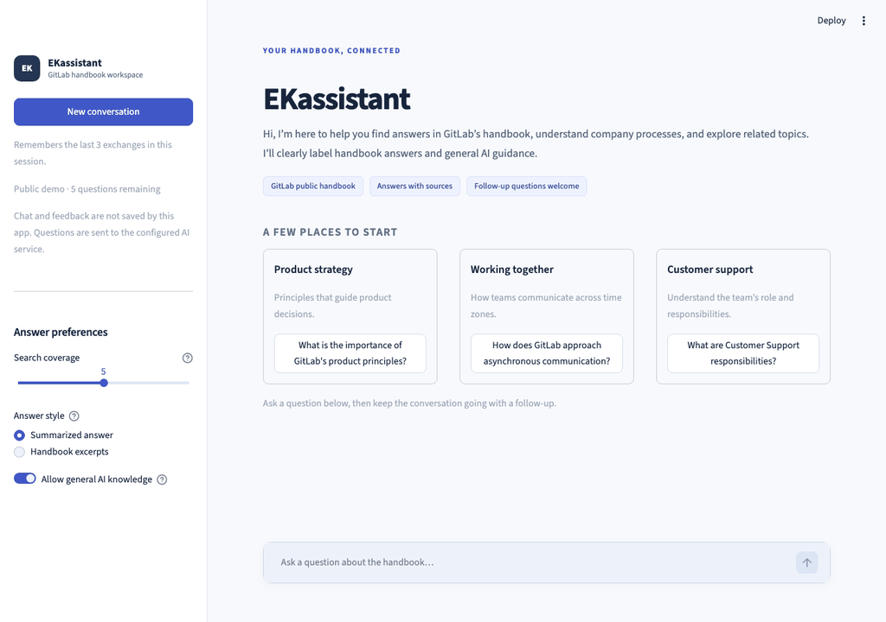

# EKassistant

**Your shortcut to answers in the company handbook.**

EKassistant is an enterprise knowledge assistant that helps people find information, understand company processes, and turn guidance into practical next steps—without searching through pages of documentation.

This demo uses selected pages from **GitLab’s public handbook**. Ask a question in everyday language, read a clear answer, and open the original sources to learn more.

## See it in action



*A 24-second recording of the app: a real Cohere answer, handbook sources, and a conversational follow-up.*

## Try the live app

**[Open EKassistant →](https://ekassistant-ma9ahil.streamlit.app/)**

The app is hosted on Streamlit. You can try it in your browser without installing anything.

## What can EKassistant do?

| Feature | What it means for you |
| --- | --- |
| **Ask in your own words** | Ask about company practices, product principles, communication, and team responsibilities. |
| **Answers from the handbook** | The assistant searches the selected handbook pages before generating an answer. |
| **Clickable sources** | Open numbered citations to see the original handbook page. Full supporting text stays tucked inside **Sources and passages**. |
| **Conversational follow-ups** | Ask “Can you explain that?” without repeating the whole topic. The assistant uses the last three exchanges for context. |
| **Two answer styles** | Choose **Summarized answer** for an AI explanation or **Handbook excerpts** for selected sentences from the handbook. |
| **Optional general AI knowledge** | With Cohere, the assistant can offer general guidance when the handbook cannot answer. Turn this off for handbook-only answers. |
| **Clear answer labels** | Handbook answers and general AI guidance are clearly distinguished. General guidance includes a short reminder to verify important details. |
| **Closest matches** | When handbook-only answers cannot resolve your question, related pages may be suggested to help you continue searching. |
| **One-click next steps** | Use **Explain more simply** or **Show practical steps** to continue the conversation. |
| **Try again** | Replace the latest answer without retyping your question. |
| **Adjustable search coverage** | Choose how many handbook sections the assistant searches for supporting information. |
| **Ready on first visit** | The bundled public handbook search snapshot loads automatically after a restart. |
| **Public demo protection** | Five questions per session, a short cooldown, hidden management controls, and a shared AI-call cap. |
| **Automatic scrolling** | New answers scroll into view, with support for reduced-motion preferences. |
| **Fresh conversations** | **New conversation** clears the chat and its remembered context. |
| **Response time** | See how long an answer took. Local development mode also offers optional diagnostics and feedback. |

## Getting started

1. Open [EKassistant](https://ekassistant-ma9ahil.streamlit.app/).
2. Pick a suggested topic or type your own question.
3. Read the answer and open its source links if you want to check the details.
4. Ask a follow-up or choose one of the next-step buttons.

A few questions to try:

- “What are GitLab’s product principles?”
- “How does GitLab approach asynchronous communication?”
- “What are Customer Support responsibilities?”
- Follow up with “Can you explain that more simply?”

The public demo prepares the handbook automatically. There is no setup button to click. Each session allows five questions, including retries and follow-ups, with at least ten seconds between requests. **New conversation** clears the chat without resetting that allowance.

## Make the answers work for you

Under **Answer preferences**:

- **Search coverage** controls how many handbook sections are searched for each question.
- **Answer style** switches between an AI summary and selected handbook sentences.
- **Allow general AI knowledge** lets Cohere offer broader guidance when the handbook does not answer. Switch it off if you only want handbook information.

Knowledge-base management is available only when the owner starts the app with `DEMO_MODE=false`; it is hidden in the public demo.

## Understanding the answers

**Handbook answers** use the information found in the selected GitLab pages and include numbered citations.

**General AI knowledge** comes from the model’s learned knowledge, rather than verified handbook information or a live web search. It is labeled separately and may be inaccurate or out of date.

This is a demonstration using a selection of public pages, not GitLab’s official assistant or a complete copy of its handbook.

## Conversation history and feedback

The conversation remains visible during your session, but only the last three exchanges are used to understand follow-ups. History is not saved as a permanent chat archive. Select **New conversation** to start fresh.

The public demo disables feedback collection and does not write questions or answers to a feedback file. Chat messages are held in session memory. For AI-generated answers, your question and recent context are sent to Cohere; provider-side retention is governed by its terms.

In local development mode (`DEMO_MODE=false`), **Helpful / Not helpful** feedback writes the timestamp, question, answer, rating, and response time to `feedback.csv`. This file is ignored by Git and is not a durable storage service on Streamlit Cloud.

## Run your own copy

The live app is the easiest way to try EKassistant. The instructions below are for someone setting up their own copy on a computer.

### 1. Install the app

Open a terminal in the downloaded project folder:

```bash
python -m venv .venv
source .venv/bin/activate
python -m pip install -r requirements.txt
cp .env.example .env
```

On Windows, activate the environment with `.venv\Scripts\activate` instead.

### 2. Connect Cohere

A Cohere API key connects the app to the service that writes AI answers. Add these settings to your local `.env` file:

```dotenv
RAG_LLM_PROVIDER=cohere
COHERE_API_KEY=your_cohere_api_key
COHERE_MODEL=command-a-plus-05-2026
COHERE_MAX_TOKENS=4096
```

### 3. Start the app

```bash
python -m streamlit run app/streamlit_app.py
```

Open the local address shown in the terminal. The included snapshot restores the handbook automatically. To enable owner controls and local feedback collection, set `DEMO_MODE=false` in your local `.env` and restart.

Restart the app after changing its Python code; automatic code watching is disabled in this project.

## Deploy your own app

The existing deployment is available at **[ekassistant-ma9ahil.streamlit.app](https://ekassistant-ma9ahil.streamlit.app/)**.

To publish your own copy on Streamlit Community Cloud:

1. Put the project in a GitHub repository.
2. Create a Streamlit app connected to that repository.
3. Set the app’s main file to `app/streamlit_app.py`.
4. Add the following in the app’s **Secrets** settings, replacing the API key placeholder:

   ```toml
   RAG_LLM_PROVIDER = "cohere"
   COHERE_API_KEY = "your_cohere_api_key"
   COHERE_MODEL = "command-a-plus-05-2026"
   COHERE_MAX_TOKENS = 4096
   DEMO_MODE = true
   DEMO_SESSION_QUESTIONS = 5
   DEMO_COOLDOWN_SECONDS = 10
   DEMO_SERVER_API_CALLS = 50
   ```

5. Deploy and open the app in a private/incognito window. The handbook should initialize automatically, without management controls or feedback buttons.

Keep real API keys in local `.env` or Streamlit Secrets, rather than in the README or committed code. After a restart, the app restores its local search database from `data/demo/handbook.json.gz`. This portable snapshot contains 970 sections from seed-listed public GitLab pages and their precomputed search vectors. Startup makes no Cohere requests and does not scrape handbook pages; the text-embedding model may still need an initial download.

### Demo limits

`DEMO_MODE=true` is the default, including when the setting is absent. Do not set it to false on the public deployment: it is a deployment setting, not an authenticated admin login.

The public demo allows five questions per browser session, including retries and follow-ups, and a ten-second cooldown. A shared cap allows at most 50 Cohere requests per server process; a general-knowledge fallback can use a second request. Automatic Cohere retries are disabled. These are lightweight demo controls: a fresh browser session resets the session allowance, and a server restart resets the shared counter. They do **not** enforce a durable monthly quota. Set a provider-side usage limit as well where available.

### Refresh the bundled handbook

From a trusted local environment, load the latest public pages and export a replacement snapshot:

```bash
python -m scripts.ingest --limit 40
python scripts/export_demo_snapshot.py
```

Commit `data/demo/handbook.json.gz` along with the code. The export accepts only URLs listed in `data/gitlab_seed_urls.txt`; private/local documents are excluded. Snapshot content is a point-in-time copy, not a live handbook feed. Original page URLs are preserved for attribution and verification.

## For developers

EKassistant uses Streamlit for the interface, sentence-transformers to find related text, and ChromaDB to store searchable handbook sections. Cohere generates the answers in the configuration above. The code also supports Vercel AI Gateway, OpenAI, Hugging Face, Ollama, and a handbook-excerpts-only mode (`RAG_LLM_PROVIDER=none`). Other providers have their own configuration; general-knowledge fallback is implemented for Cohere.

| Location | Purpose |
| --- | --- |
| `app/streamlit_app.py` | Chat interface and user controls. |
| `app/assets/styles.css` | Visual styling. |
| `rag/` | Loads handbook pages, searches them, manages conversation context, and generates answers. |
| `data/gitlab_seed_urls.txt` | The list of handbook pages available to load. Add URLs here to extend the demo collection. |
| `data/demo/handbook.json.gz` | Bundled public search data restored automatically at startup. |
| `rag/demo.py` | Public demo session limits and shared AI-call budget. |
| `scripts/export_demo_snapshot.py` | Exports a portable snapshot of seed-listed public pages. |
| `scripts/ingest.py` | Prepares handbook pages for search from the command line. |
| `scripts/evaluate.py` | Checks whether searches find the expected handbook pages. |
| `tests/` | Automated checks for answer generation and conversation behavior. |

Run the checks:

```bash
python -m unittest discover -s tests -v
```

Evaluate handbook search after loading the knowledge base:

```bash
python scripts/evaluate.py --k 5
```

The interface draws on [Microsoft’s Human-AI Interaction guidelines](https://www.microsoft.com/en-us/haxtoolkit/ai-guidelines/) and [Nielsen Norman Group’s chatbot design guidance](https://www.nngroup.com/articles/ai-chatbots-design-guidelines/), particularly clear expectations, source visibility, easy correction, and user control.
